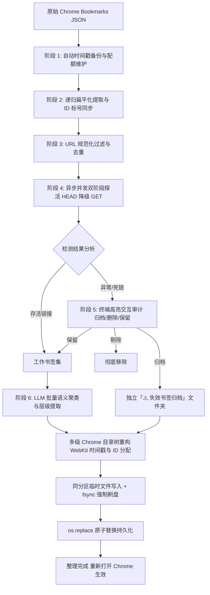

# Chrome 书签自动整理与健康检查工具技术与使用指南

本项目是一款基于 Python、`aiohttp` 异步高并发网络探活引擎与大语言模型（LLM）语义聚类的 Chrome 书签自动化健康检查与智能归类整理工具。

---

## 目录

- [一、项目背景与核心价值](#一项目背景与核心价值)
- [二、系统架构与流水线设计](#二系统架构与流水线设计)
- [三、核心技术机制实现](#三核心技术机制实现)
- [四、环境准备与依赖安装](#四环境准备与依赖安装)
- [五、配置说明与模型接入](#五配置说明与模型接入)
- [六、完整使用与操作指南](#六完整使用与操作指南)
- [七、代码模块架构与 API 参考](#七代码模块架构与-api-参考)
- [八、异常排查与一秒回滚方案](#八异常排查与一秒回滚方案)
- [九、自动化测试与代码审计](#九自动化测试与代码审计)

---

## 一、项目背景与核心价值

日常使用 Chrome 浏览器积累大量书签后，普遍面临以下痛点：
1. **死链积压**：网站下线、域名到期、页面 404，大量书签失效却难以人工逐个验证。
2. **重复冗余**：同类页面、不同锚点（Fragment）或格式差异导致大量重复书签。
3. **层级混乱**：缺乏语义分类，书签树层级深浅不一，查找效率低下。
4. **数据损坏风险**：Chrome 采用内存常驻机制，直接暴力修改磁盘文件容易导致浏览器覆盖丢失或格式损坏。

本工具通过严密的六阶段管道（Pipeline）与防御性持久化设计，在**绝对保障书签数据安全**的前提下，实现毫秒级探活、人机协同决策与高精度语义自动归类。

---

## 二、系统架构与流水线设计

系统采用**低耦合、高内聚**的模块化管道架构，严格拆分为六个流水线阶段：



### 六阶段管道详情

| 阶段 | 核心任务 | 关键逻辑与安全性保护 |
| :--- | :--- | :--- |
| **1. 自动备份** | 生成时间戳快照 | 读写前强制生成 `Bookmarks.bak_<timestamp>`，自动维护最近 10 份历史备份配额 |
| **2. 扁平化提取** | 遍历整树并同步 ID | 递归扫描 `bookmark_bar`，计算全局 `max_id`，将树状 URL 节点提取为扁平列表 |
| **3. 规范化去重** | 过滤无效项与清洗 URL | 滤除非 HTTP(S) 协议；清洗结尾斜杠与锚点（`#hash`），完整保留查询参数（`?query`）去重 |
| **4. 异步并发探活** | 高吞吐量非阻塞探活 | `aiohttp` 信号量限制并发（默认 30），HEAD 优先遇 405/网络异常降级流式 GET，放行 401/403/429 |
| **5. 终端交互审计** | 异常链接人机协同决策 | 终端高亮打印状态码与 URL；支持三种处置：[1] 自动归档、[2] 直接剔除、[3] 忽略保留 |
| **6. 语义聚类与重构** | LLM 聚类与原子持久化 | 批量送入 LLM 生成多级目录路径；自增分配全局 ID；通过临时文件 `fsync` + 原子 `os.replace` 写入 |

---

## 三、核心技术机制实现

### 1. WebKit 纪元微秒时间戳算法
Chrome 书签的 `date_added` 和 `date_modified` 采用 WebKit 纪元标准（自 1601 年 1 月 1 日 00:00:00 UTC 以来的微秒数）。时间戳计算遵循以下公式：

$$\text{Timestamp}_{\text{Chrome}} = (\text{Unix\_Timestamp} + 11644473600) \times 10^6$$

代码实现位于 `bookmark_cleaner/config.py`，保证重构节点完全符合 Chrome 内部时间戳格式标准。

### 2. 全局唯一 ID 连续分配器 (`IdManager`)
Chrome 依靠字符串形式的数值 ID 维护节点索引。
- 启动时扫描原始书签树的所有节点（包括历史文件夹与书签），取得当前最大的整型编号 `max_id`。
- 在后续构建新分类文件夹与归档目录时，严格通过 `allocate_id()` 执行单调自增（`max_id + 1`），杜绝 ID 碰撞导致的 Chrome 崩溃或书签丢失。

### 3. 双阶段异步网络探活引擎 (`prober.py`)
- **HEAD 优先**：首选拉取响应头，不下载包体，网络消耗降低 95% 以上。
- **GET 流式降级**：当服务器返回 `405 Method Not Allowed`、反爬拦截 HEAD 或网络报错时，降级采用 GET 方法读取响应头，不预读大体积包体。
- **特权状态码放行**：
  - `401 Unauthorized`（需登录认证，站点存活）
  - `403 Forbidden`（权限受限或防爬拦截，站点存活）
  - `429 Too Many Requests`（触发限频，站点存活）
- **瞬时网络抖动重试**：针对 `5xx` 服务端异常及偶发连接超时，内置指数退避重试机制（退避间隔 0.5s/1.0s）。
- **SSL 容错保护**：默认禁用严格 SSL 证书验证（`ssl=False`），防止内网自建服务、过期证书被误杀；亦可通过命令行参数 `--ssl-verify` 显式开启严格校验。

### 4. 临时文件原子替换持久化 (`storage.py`)
为彻底规避写入中断或断电导致 Chrome 书签被截断损坏，持久化采用操作系统级原子操作：
1. 在与目标文件相同的目录下创建临时文件（保证处于同一底层文件系统挂载点）。
2. 将格式化 JSON 写入临时文件，显式调用 `flush()`。
3. 调用 `os.fsync(temp_file.fileno())` 将数据从操作系统内核缓冲区强制刷入磁盘硬件。
4. 关闭文件句柄后，调用 `os.replace(temp_path, bookmark_path)` 完成原子重命名替换。

---

## 四、环境准备与依赖安装

### 1. 系统要求
- **Python 版本**：Python 3.10+（已在 Python 3.14 macOS 环境完成严格验证）
- **支持操作系统**：macOS、Windows、Linux

### 2. Chrome 书签默认路径对照

| 操作系统 | 默认书签存储路径 |
| :--- | :--- |
| **macOS** | `~/Library/Application Support/Google/Chrome/Default/Bookmarks` |
| **Windows** | `%LOCALAPPDATA%\Google\Chrome\User Data\Default\Bookmarks` |
| **Linux** | `~/.config/google-chrome/Default/Bookmarks` |

### 3. 安装依赖

进入项目根目录：
```bash
# 1. 创建独立虚拟环境
python3 -m venv .venv

# 2. 激活虚拟环境
# macOS / Linux:
source .venv/bin/activate
# Windows:
# .venv\Scripts\activate

# 3. 安装核心依赖
pip install -r requirements.txt
```

核心依赖清单：
- `aiohttp>=3.9.0`：高性能异步非阻塞 HTTP 探活
- `openai>=1.12.0`：标准兼容 LLM 客户端
- `pytest>=8.0.0`、`pytest-asyncio>=0.23.0`：自动化测试套件

---

## 五、配置说明与模型接入

工具通过环境变量灵活适配各种主流大模型与自建 LLM 接口：

### 1. 环境变量配置表

| 环境变量名 | 默认值 | 说明 |
| :--- | :--- | :--- |
| `OPENAI_API_KEY` | `""` | 模型 API Key |
| `OPENAI_BASE_URL` / `OPENAI_API_BASE` | `https://api.openai.com/v1` | 兼容接口 Base URL |
| `MODEL_NAME` | 智能判定 / `gpt-4o-mini` | 大模型名称 |
| `MAX_CONCURRENT_REQUESTS` | `30` | 网络探活最大并发数 |
| `REQUEST_TIMEOUT_SECONDS` | `7.0` | 单链接探活超时时间（秒） |
| `BATCH_SIZE` | `25` | 单批次送入 LLM 语义聚类的书签数量 |
| `SSL_VERIFY` | `false` | 是否开启严格 SSL 证书校验 |

### 2. 常见模型厂商配置示例

#### 选项 A：MiniMax (推荐)
```bash
export OPENAI_API_KEY="sk-cp-xxxxxxxxxxxxxxxx"
export OPENAI_BASE_URL="https://api.minimax.chat/v1"
export MODEL_NAME="MiniMax-M2.7"
```

#### 选项 B：DeepSeek
```bash
export OPENAI_API_KEY="sk-xxxxxxxxxxxxxxxx"
export OPENAI_BASE_URL="https://api.deepseek.com"
export MODEL_NAME="deepseek-chat"
```

#### 选项 C：OpenAI 官方接口
```bash
export OPENAI_API_KEY="sk-xxxxxxxxxxxxxxxx"
export OPENAI_BASE_URL="https://api.openai.com/v1"
export MODEL_NAME="gpt-4o-mini"
```

#### 选项 D：本地 Ollama 服务
```bash
export OPENAI_API_BASE="http://localhost:11434/v1"
export OPENAI_API_KEY="ollama"
export MODEL_NAME="qwen2.5:7b"
```

---

## 六、完整使用与操作指南

### 步骤 1：彻底退出 Chrome 浏览器（极其重要）
> [!CAUTION]
> Chrome 运行时常驻内存，关闭进程时会以内存快照无条件覆盖磁盘 Bookmarks 文件。**执行整理工具前，必须彻底杀死 Chrome 后台进程！**

- **macOS**：
  ```bash
  killall "Google Chrome"
  ```
- **Windows**：
  在任务管理器中确保已无 `chrome.exe` 残留进程，或执行：
  ```cmd
  taskkill /F /IM chrome.exe
  ```
- **Linux**：
  ```bash
  pkill -f chrome
  ```

### 步骤 2：启动书签整理

#### 方式 1：启动 Web UI 现代化管理控制台 (推荐)
```bash
python bookmark_manager.py --ui
# 或指定自定义端口
python -m bookmark_cleaner.cli --ui --port 8080
```
启动后在浏览器打开 `http://127.0.0.1:8080`，即可享受沉浸式玻璃质感（Glassmorphism）可视化工作台：
- **实时指标看板**：展示书签总数、去重后保留数、重复数与历史快照数。
- **环境安全雷达**：实时检测 Chrome 进程运行状态，避免内存常驻快照覆盖。
- **死链交互审计卡片**：状态码分组高亮，支持单项/批量选择自动归档、彻底删除或忽略保留。
- **AI 分类与目录树重构预览**：重构结果折叠树形可视化，确认无误后一键原子覆写写入。
- **一秒快照恢复中心**：可视化快照版本列表，随时一键回滚。

#### 方式 2：终端 CLI 直接运行
```bash
python bookmark_manager.py
```
控制台将提示确认 Chrome 退出，按回车键即可开始流水线执行。

#### 方式 3：使用 CLI 高级参数
```bash
python -m bookmark_cleaner.cli [参数选项]
```

**CLI 参数列表**：
```text
options:
  -h, --help            显示帮助信息
  --path PATH           指定自定义 Chrome 书签文件路径（默认自动匹配当前操作系统）
  --action {archive,delete,keep}
                        预设对失效书签的处置策略（跳过交互直接执行）：
                        - archive: 自动归档至「⚠️ 失效书签归档」
                        - delete:  彻底从书签树中删除
                        - keep:    保留并正常随同分类
  -y, --yes             跳过执行前的退出 Chrome 确认交互
  --batch-size INT      LLM 批处理切片大小 (默认: 25)
  --concurrency INT     最大异步网络并发数 (默认: 30)
  --model MODEL         大模型名称 (默认由 BASE_URL 智能判定)
  --base-url URL        OpenAI 兼容接口 Base URL
  --ssl-verify          开启严格 SSL 证书验证 (默认关闭)
```

**常用快捷命令**：
```bash
# 无人值守全自动归档执行：
python -m bookmark_cleaner.cli --action archive -y

# 指定自定义书签文件路径与大模型：
python -m bookmark_cleaner.cli --path "/path/to/Bookmarks" --model "deepseek-chat"
```

### 步骤 3：终端交互确认失效链接
若未指定 `--action`，探活完成后终端将列出所有异常书签明细：

```text
================================================================================
⚠️  共识别出 3 个疑似无法访问的书签：
================================================================================
[01] 异常状态: HTTP 404           | 标题: 旧项目技术博客
     链接地址: https://old-blog.example.com/article/1
[02] 异常状态: TimeoutError       | 标题: 废弃服务控制台
     链接地址: https://console.expired-service.io
[03] 异常状态: ClientConnectorError| 标题: 域名已过期站点
     链接地址: https://defunct-domain.com
================================================================================
请选择对上述失效书签的处置方式：
  [1] 自动归档（默认：分类存入「⚠️ 失效书签归档」独立文件夹）
  [2] 直接剔除（从整理结果中彻底移除）
  [3] 忽略异常（保留并正常随同分类）
请输入选项编号 [1/2/3] (直接回车默认 1): 1
```

### 步骤 4：重新启动 Chrome 验证
处理完成后，重新启动 Chrome 浏览器，书签栏已重构为结构清晰的树形分类，失效书签已被安全归纳在「⚠️ 失效书签归档」文件夹中。

---

## 七、代码模块架构与 API 参考

工程代码严格恪守低耦合高内聚设计，各模块职责明确，单文件行数均控制在合理范围内：

```text
bookmark/
├── bookmark_cleaner/
│   ├── __init__.py      # 包导出入口 (54 行)
│   ├── config.py        # 环境读取、时间戳计算与路径适配 (73 行)
│   ├── storage.py       # 快照备份、配额维护与原子持久化 (95 行)
│   ├── parser.py        # 扁平化提取、URL 规范化去重与 ID 管理 (94 行)
│   ├── prober.py        # 异步并发双阶段探活引擎与重试 (124 行)
│   ├── classifier.py    # LLM 语义聚类、重试与降级保护 (131 行)
│   ├── builder.py       # 多层目录树重构与归档节点装配 (81 行)
│   └── cli.py           # 六阶段流水线调度器与 CLI (318 行)
├── bookmark_manager.py  # 顶层直接启动脚本与兼容包装类 (93 行)
├── scripts/
│   └── minimax_audit.py # MiniMax 独立交叉代码审计脚本 (80 行)
├── tests/               # 完整单元测试与端到端集成测试 (498 行)
└── docs/                # 本说明文档目录
```

### Python API 编程式调用示例

开发者亦可在 Python 代码中直接导入模块使用：

```python
import asyncio
from pathlib import Path
from bookmark_cleaner import BookmarkWorkflow, get_default_bookmark_path

async def run_custom_clean():
    # 初始化工作流
    workflow = BookmarkWorkflow(
        bookmark_path=get_default_bookmark_path(),
        model_name="MiniMax-M2.7",
        batch_size=20,
        max_concurrency=40
    )
    
    # 执行流水线（指定自动归档并跳过确认）
    await workflow.execute(dead_action_override="archive", skip_confirm=True)

if __name__ == "__main__":
    asyncio.run(run_custom_clean())
```

---

## 八、异常排查与一秒回滚方案

### 1. 一秒无损回滚机制
本工具在对 `Bookmarks` 进行任何写操作前，均会强制生成以当前时间戳命名的备份文件。

**回滚步骤**：
1. 彻底退出 Chrome：`killall "Google Chrome"`
2. 进入 Chrome 书签所在目录：
   - macOS: `cd "$HOME/Library/Application Support/Google/Chrome/Default"`
   - Windows: `cd "%LOCALAPPDATA%\Google\Chrome\User Data\Default"`
3. 查看最近生成的备份文件：
   ```bash
   ls -lt Bookmarks.bak_*
   ```
4. 将最新的备份文件覆写回 `Bookmarks`：
   ```bash
   cp Bookmarks.bak_20261011_083000 Bookmarks
   ```
5. 重新打开 Chrome，书签瞬间恢复至整理前完全一致的状态。

### 2. 常见问题排查表

| 现象 | 根因排查 | 解决方案 |
| :--- | :--- | :--- |
| **重新打开 Chrome 后分类未改变** | 运行脚本时 Chrome 仍有后台进程，浏览器关闭时用内存数据覆盖了磁盘文件。 | 彻底杀死 Chrome 进程（`killall "Google Chrome"`）后重新执行脚本。 |
| **内网/本地服务全部显示为死链** | 存在过期证书或自建证书，且开启了严格校验；或网络代理拦截。 | 默认 `ssl=False` 已放行无效证书；若使用了全局代理，可在当前终端临时 `unset http_proxy https_proxy`。 |
| **大模型分类报错 Rate Limit (429)** | 调用频率过高触发模型提供商限频。 | 在运行时调小切片大小，如 `--batch-size 10`。工具内置了指数退避重试与降级保护机制。 |
| **未配置 API Key** | 未设置 `OPENAI_API_KEY` 环境变量。 | 工具会自动输出友好提示，并安全降级将书签归入「其他/待整理」分类，保证程序不中断。 |

---

## 九、自动化测试与代码审计

### 1. 运行自动化测试套件
项目采用 `pytest` + `pytest-asyncio` 进行覆盖率全面的自动化测试：
```bash
pytest -v
```

测试套件涵盖：
- `test_storage.py`：备份生成、配额清理、原子刷盘写入与异常恢复。
- `test_parser.py`：节点递归提取、ID 自增单调性、保留 Query 参数的 URL 规范化与去重。
- `test_prober.py`：HEAD 成功、401/403/429 特权放行、405 降级 GET、超时退避与空输入处理。
- `test_builder.py`：单层/多层目录树嵌套构建、失效节点归档文件夹装配。
- `test_classifier.py`：API Key 缺失降级、外层嵌套字典解析、网络异常重试退避。
- `test_pipeline.py`：端到端六阶段全流程模拟执行与结构校验。

机验指标：**24 项测试用例全部通过，退出码为 0**。

### 2. 运行 MiniMax 独立交叉代码审计
项目内置针对真实代码质量红线的审计驱动脚本：
```bash
python scripts/minimax_audit.py
```
审计脚本自动提取所有核心模块源码，拉起 MiniMax 模型，依据**低耦合高内聚、单文件规模、交付真实性、健壮性与幂等性**四项硬性标准进行审查。
